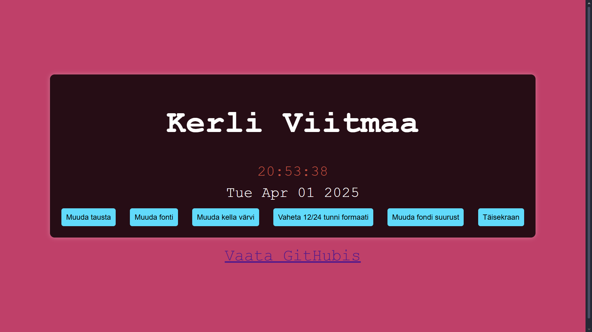

# Kohandatav Lauakell

## Autor
[Kerli Viitmaa]

## Ekraanipilt

() 
*Ekraanipilt rakendusest*

## Funktsionaalsus

Veebipõhine lauakell kuvab kella, kuupäeva ja nädalapäeva. Kella saab kohandada järgmiste omadustega:

- Kella suurus: Võimalik muuta kella numbrite suurust, klõpsates neile ja sisestades uue suuruse.
- Tausta muutmine: Saab muuta tausta värvi klõpsates nuppule "Muuda tausta".
- Fondimuutmine: Saab muuta kella fonti ja fondi suurust, klõpsates nuppudele "Muuda fonti" ja "Muuda fondi suurust".
- Aja formaat: Võimalik vahetada 12/24 tunni formaadi nuppude abil.
- Ekraan: Saab panna ka täisekraaniks. 

Rakendus sisaldab ka linki GitHubi hoidla juurde.

## Koodipromptide Viited

- Kella loomiseks ja tausta muutmiseks kasutasin järgmisi promptide juhiseid:
    - Prompt: "Loo veebirakendus, mis kuvab kella ja kuupäeva ning võimaldab muuta kella numbrite suurust ja tausta värvi."
    - Prompt: "Kood, mis võimaldab ekraanil olevat kellaaega muuta ja liikuda kasutaja nooleklahvidega."
    - Prompt: "Fondi suuruse ja muudatuste funktsionaalsus veebirakenduses."
    - Promt: "Kuidas on võimalik täisekraaniks teha?"
    

